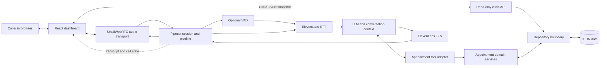
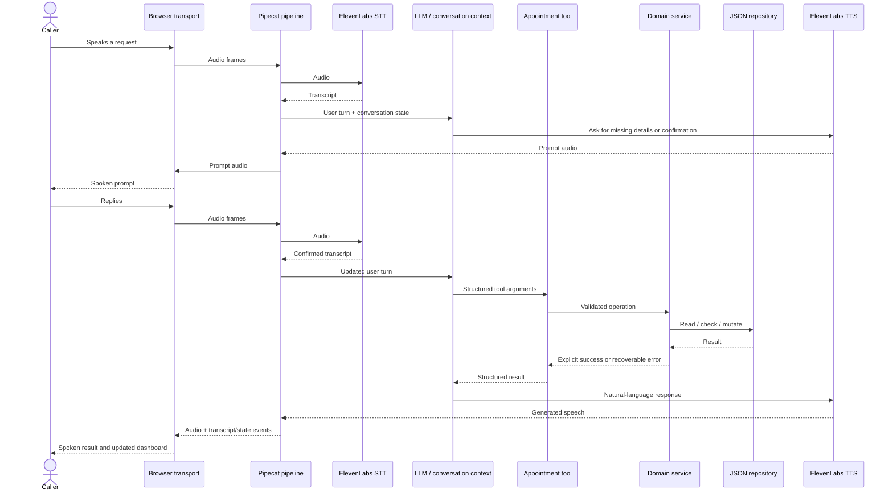

# Architecture and Build Guide

This guide describes how to build the assignment from the system boundary down to its core components. The first implementation milestone is the working Pipecat voice pipeline and its appointment tools. Build the dashboard afterward as a thin client of the same capabilities; React is a reasonable choice, but it is not a prerequisite for proving the core workflow.

## 1. Scope and decisions

### Required

- A real-time voice agent built with Pipecat (Python).
- Speech-to-text (STT) and text-to-speech (TTS) using ElevenLabs.
- Gemini is the selected LLM for the planned voice pipeline.
- Tools to check doctor availability, book an appointment, and cancel an appointment.
- Caller identity based only on the phone number the caller says aloud. Read the number back and get confirmation before booking or cancelling.
- A dashboard that can start/end a browser call, show a live transcript, list doctors and slots, and reflect appointment changes.

Doctors, specialties, slots, and appointments may start as mock data in memory, JSON, or SQLite. The implemented first slice uses JSON-backed local data behind a small repository boundary, so the prototype stays simple and persistence can be replaced later.

### Not a first milestone

The assignment's bonus items (VAD, a phone-style call screen, waveform, sounds, animations, richer responsive behavior, and other polish) are optional. Keep integration seams for them, but do not let them delay the required voice workflow.

## 2. System at a glance

The browser is a caller and an observer of the session. Pipecat owns the real-time conversation; appointment tools call domain services, which read and mutate the same data source shown by the dashboard.



VAD is an optional audio-processing stage, not a second conversation path. When it is disabled, audio proceeds directly to STT. The exact browser transport and Pipecat transport implementation can be selected when the application is scaffolded; keep audio transport concerns out of appointment logic.

## 3. One conversation, end to end



The diagram omits repeated turns for brevity. A tool call may require more than one caller turn: gather details, read back the phone number and requested appointment action, obtain confirmation, then invoke the mutation.

## 4. Build from the core outward

| Order | Component | Responsibility and completion check |
| --- | --- | --- |
| 1 | Appointment data and domain services | Define doctors, specialties, slots, and appointment rules. Test availability, successful booking, duplicate booking prevention, and cancellation without any audio or LLM dependency. |
| 2 | Pipecat session and transport | Start/end one browser voice session and connect its audio input/output to the pipeline. Keep the transport replaceable and report connection state. |
| 3 | STT and TTS adapters | Connect ElevenLabs STT/TTS to the pipeline; verify a caller turn can be transcribed and an agent response can be heard. |
| 4 | Conversation context and LLM | Handle intent, collect missing details, select a doctor/specialty/slot from tool results, and request confirmation before mutations. |
| 5 | Registered appointment tools | Connect the three required tools to domain services. Verify all three end-to-end and ensure failures never sound like success. |
| 6 | Dashboard client | Implemented as a thin React client with call controls, transcript/status, doctors, available slots, and refreshed appointment data. |
| 7 | Optional improvements | Add bonus features through the extension seams below only after the required workflow is reliable. |

Keep the data/domain tests and tool tests runnable without calling paid or network speech/LLM services. Add a small number of full integration checks with provider calls enabled only when credentials and network access are available.

## 5. Pipecat pipeline components

| Component | Input → output | Keep this responsibility here |
| --- | --- | --- |
| Browser transport | Browser microphone audio → pipeline audio frames; pipeline audio/events → browser | The current local development path uses Pipecat SmallWebRTC. Connection lifecycle, audio framing, and transport-level errors stay outside appointment rules. |
| VAD | Audio frames → speech/start/stop boundaries | The current pipeline uses Silero VAD for caller-turn aggregation and VAD-based ElevenLabs realtime STT commits. It can be tuned or replaced without changing appointment logic. |
| ElevenLabs STT | Caller audio → recognized text | Transcription only. Treat uncertain or empty transcription as something to clarify, not as a reliable phone number or consent. |
| Conversation context | Current turn + bounded session state → LLM input | Track the selected doctor/slot and confirmation state for this call. Do not use prior calls or caller-ID as identity. |
| LLM | Context → response or structured function call | Converse naturally and choose among real tool results. It must not invent doctors, availability, booking IDs, or successful mutations. |
| Tool adapter | Structured arguments → validated result | Define narrow schemas, validate required fields, call a domain service, and return a predictable result to the LLM. |
| Domain service/repository | Operation → authoritative result | Apply availability and appointment rules to the data source. This is the source of truth, not the LLM or the transcript. |
| ElevenLabs TTS | Agent response text → audio | Speak the response. A TTS failure is a call failure/degradation, not evidence that the underlying operation failed or succeeded. |
| Browser event client | Session events → visible status/transcript/data refresh | Render session state and refresh lists from the same authoritative backend data. It must not infer a booking from an LLM sentence alone. |

Use the Pipecat pipeline for streaming and turn orchestration. Keep provider-specific setup behind small adapters/configuration so a provider can later be swapped without rewriting tool or appointment rules.

The initial implementation registers three direct Python function tools in Gemini's `LLMContext`. Each callback forwards only validated arguments to the provider-neutral `AppointmentToolAdapter`; the adapter remains the boundary for domain rules and structured results. A fresh repository service and confirmation state are created per browser call. Assistant-turn and caller-turn aggregator events connect delivered read-backs and caller transcripts to that state. Disconnect clears it.

Each session also provides Gemini with the current date in the configured clinic timezone so relative dates such as “tomorrow” are grounded consistently. Runtime logs default to INFO because provider DEBUG logs may include complete conversation context and tool arguments containing personal data.

### Cost control: silence during realtime STT

The current pipeline sends WebRTC audio directly to ElevenLabs realtime STT. Silero VAD is used for turn aggregation and VAD-based transcript commits, but it does **not** gate upstream audio or pause the STT stream while the caller is silent. If realtime STT usage is metered by elapsed stream/audio duration, silent periods may still consume credits.

Treat silence billing as a known cost risk to verify against the account's usage analytics during a controlled idle test. A follow-up should compare usage with and without silence, then consider VAD-gated audio forwarding or pausing/restarting STT after an idle timeout. Preserve audio pre-roll and resume behavior so the first words after a pause are not clipped, and verify billing before choosing the implementation.

## 6. Appointment tools and conversation rules

The assignment requires these three tools. Names below match the assignment; argument names are illustrative and should become explicit typed schemas in the implementation.

| Tool | Purpose | Important behavior |
| --- | --- | --- |
| `check_doctor_availability` | Return real available slots, optionally narrowed by doctor, specialty, and date. | If the caller has not given enough information, ask a follow-up. Offer only slots returned by the repository. Return stable slot/doctor IDs alongside readable labels and time-zone-aware timestamps. |
| `book_appointment` | Reserve a selected slot for the spoken phone number. | Before calling it, read the number back and obtain clear confirmation of both the number and selected slot. Recheck availability and reserve atomically; return a booking ID only after the write succeeds. |
| `cancel_appointment` | Cancel an existing appointment associated with the spoken phone number. | Read the number and target appointment back and obtain confirmation. If the number matches multiple appointments and the caller has not selected one, ask which one; do not cancel an arbitrary match. |

### Trust and mutation boundary

The caller's spoken phone number is the only identity source required by the assignment: do not substitute browser identity, caller-ID, login, or OTP. A spoken number is not proof of legal identity; use it only as the assignment's lookup key. Normalize a number carefully while retaining the caller's original form for read-back. Avoid putting full phone numbers in routine logs or dashboard rows.

Make the confirmation gate explicit in session/application state. Do not rely only on an LLM-generated `confirmed: true` argument: the application should record the caller's affirmative response to a specific number and specific booking/cancellation target, and invalidate that confirmation if either changes. Require the confirmation state at the domain/tool boundary before mutation.

Keep tool outputs machine-readable, for example:

```json
{
  "ok": true,
  "operation": "check_doctor_availability",
  "slots": [
    {
      "id": "slot-203",
      "doctorId": "doctor-12",
      "doctorName": "Dr. Example",
      "specialty": "Cardiology",
      "startsAt": "2026-12-01T10:30:00+05:30"
    }
  ]
}
```

Errors should also have a stable shape, such as `ok: false`, a safe `code` (`slot_unavailable`, `not_found`, `confirmation_required`, `temporarily_unavailable`), and a short user-safe message. The LLM can phrase the message naturally, but must preserve its meaning.

## 7. JSON data model

Start with explicit, small records. Store references by stable IDs rather than copying names into every relationship.

```json
{
  "specialties": [
    { "id": "cardiology", "name": "Cardiology" }
  ],
  "doctors": [
    {
      "id": "doctor-12",
      "name": "Dr. Example",
      "specialtyIds": ["cardiology"]
    }
  ],
  "slots": [
    {
      "id": "slot-203",
      "doctorId": "doctor-12",
      "startsAt": "2026-12-01T10:30:00+05:30",
      "status": "available"
    }
  ],
  "appointments": []
}
```

- Store timestamps with an explicit UTC offset or as UTC plus a separately defined display time zone; never interpret an ambiguous local time silently.
- A booking links to a slot and stores only the caller phone number needed by the assignment. A minimal appointment record can include `id`, `slotId`, `doctorId`, `callerPhone`, `status`, and `createdAt`.
- Keep repository operations small, for example `list_doctors`, `find_available_slots`, `book_slot`, and `cancel_appointment`. Tool adapters should not parse or write JSON files directly.
- For a local prototype, load seed records from JSON and serialize mutations through one repository. If writing JSON back to disk, use an atomic replacement and serialize writes; this is a single-process demo strategy, not multi-instance production storage.
- If durability, multiple workers, or concurrent callers become important, replace the repository implementation with SQLite or a service database. Preserve tool and domain contracts.

## 8. Failure handling and fallback paths

Fail explicitly and preserve data correctness. A fallback must never make an unavailable or failed operation look successful.

| Failure | Expected behavior | Extension point |
| --- | --- | --- |
| Browser permission, device, or transport failure | Show a clear connection/microphone state and allow retry or a clean end-call. Do not fabricate a transcript. | Swap or extend the browser transport independently of appointment logic. |
| VAD disabled or unavailable | Continue through the normal STT path if the selected transport supports it. | Add/replace a VAD processor without changing tools. |
| STT timeout, empty result, or provider error | Ask the caller to repeat once when appropriate; otherwise explain that the call cannot continue and end gracefully. Do not guess phone digits. | Configure a compatible secondary STT adapter only if deliberately supported and tested. |
| LLM timeout or malformed tool arguments | Do not execute a mutation. Give a brief recovery message, retry only within a bounded policy, or end the call. | Change LLM provider through the model adapter/configuration. |
| Slot was taken after it was offered | Recheck and reject the stale selection; offer newly available slots. | Repository transaction/locking policy. |
| JSON/data read or write failure | Return a safe tool error, leave the appointment unchanged, and do not announce success. Log diagnostic details without secrets or full phone numbers. | Replace local repository with SQLite/database. |
| TTS failure | Surface the degraded/failed call state in the dashboard if available; do not claim the caller heard a response. Preserve a completed data operation and report its result honestly through any remaining channel. | Alternate TTS adapter or text-visible status channel. |
| Duplicate/retried tool request | Prevent a second booking/cancellation where possible; return the existing operation result or a clear conflict. | Add an idempotency key and durable transaction support when moving beyond the local demo. |

Never silently fall back to hard-coded availability, mock a provider response after a live request fails, or mark a booking complete before the repository confirms it.

## 9. Dashboard boundary

The React dashboard consumes Pipecat session events and a read-only clinic snapshot from `GET /api/clinic`; it does not contain appointment rules or connect directly to the JSON file. Its current local-development version includes:

- Start and end browser voice calls using Pipecat's SmallWebRTC client.
- Show connecting/connected/ended or failed call states and the live transcript.
- List doctors, specialties, and currently available slots.
- List appointments and refresh the snapshot while a call is active and after disconnect.

The Pipecat runner hosts the read-only snapshot route beside `/start` and the WebRTC offer route under `/sessions/{session_id}/api/offer`; Vite proxies all three route prefixes during local development. The snapshot omits caller phone numbers. Booking and cancellation still happen only through the voice/tool/domain flow, not through dashboard write endpoints. This unauthenticated development API must not be exposed publicly; add authentication and authorization before any shared deployment.

## 10. Optional bonus extension seams

These are not required for the first working submission. Add them as independent capabilities:

- **VAD:** optional processor before STT; enable/disable through pipeline configuration.
- **Phone-style call screen, timer, mute, waveform, sounds, transitions, mobile layout:** dashboard presentation layered over session state, without changing booking rules.
- **Persistence upgrade:** new repository adapter (SQLite/database) implementing the same domain operations.
- **Provider alternatives:** adapters/configuration for compatible STT, LLM, or TTS providers; preserve the same tool contracts.
- **Observability:** structured session/tool events, provider latency/error metrics, and redacted logs. Do not log API keys, raw audio, or full phone numbers by default.
- **Additional specialties, doctors, appointment policies, or workflows:** add data/configuration and domain operations first; expose new tool capabilities deliberately rather than embedding policy in a prompt.

## 11. Configuration and local setup checklist

The checked-in `.env.example` lists the actual local settings. Copy it to `.env` and add credentials locally. `.env` is ignored; the example contains empty secret fields and remains trackable.

- `GOOGLE_API_KEY`, `GEMINI_MODEL`
- `ELEVENLABS_API_KEY`, `ELEVENLABS_VOICE_ID`, `ELEVENLABS_STT_MODEL`, `ELEVENLABS_TTS_MODEL`
- `CLINIC_TIMEZONE` (IANA timezone, defaults to `Asia/Kolkata`)
- Pipecat's local WebRTC runner owns the development server/port configuration.

Voice startup validates required setting names and reports missing variables without echoing credential values. The manual CLI and domain tests do not require provider credentials.

## 12. Running the current implementation

The repository includes the appointment domain, tool adapter, manual CLI, and an initial Pipecat voice pipeline. The custom React dashboard is still a later milestone. The Pipecat development client is available for exercising browser audio. Google Calendar is not required; this prototype uses JSON as permitted by the assignment.

Requirements: Python 3.11 or later. On Windows, create the environment and install the project from the repository root:

```powershell
py -3.12 -m venv .venv
.\.venv\Scripts\python -m pip install -e .
Copy-Item .env.example .env
```

Set `GOOGLE_API_KEY`, `ELEVENLABS_API_KEY`, and `ELEVENLABS_VOICE_ID` in the local `.env` file to make voice calls. To preview clinic data or filter availability (no provider credentials needed):

```powershell
.\.venv\Scripts\python -m backend.app.main
.\.venv\Scripts\python -m backend.app.main availability --date 2026-12-01 --doctor doctor-101
.\.venv\Scripts\python -m backend.app.main availability --specialty cardiology
```

Book/cancel can be exercised interactively with the same per-call confirmation gate:

```powershell
.\.venv\Scripts\python -m backend.app.main book --slot-id slot-201 --phone-number "+91 98765 43210"
.\.venv\Scripts\python -m backend.app.main cancel --phone-number "+91 98765 43210"
```

Run the local browser voice pipeline and open its Pipecat client:

```powershell
.\.venv\Scripts\python -m backend.app.pipeline -t webrtc
```

Open `http://localhost:7860/client`, allow microphone access, and connect. This development UI is not the eventual custom dashboard.

The sample timestamps are timezone-aware; date filtering interprets a requested date in the configured clinic timezone. Runtime changes are stored in ignored `backend/data/state.json`. To restore the original sample, remove that specific file; the next run will load `backend/data/seed.json`.

Run all domain, tool, CLI, and configuration tests (these do not make provider calls):

```powershell
.\.venv\Scripts\python -m unittest discover -s backend\tests -t . -v
```

## 13. Appointment tool contracts

The provider-neutral tool adapter is implemented in `backend/app/tools.py`; `backend/app/pipeline.py` registers availability, booking, and cancellation as direct function tools with the selected Gemini service. Each handler routes into `AppointmentToolAdapter.execute` and returns its structured result to the LLM context.

The booking/cancellation schemas deliberately do not accept `confirmed`, `confirmation`, or another model-controlled consent field. On the first valid mutation request, the adapter returns a `confirmation_required` result containing the exact selected target and phone number to read back. The per-call `CallConfirmationState` only authorizes the action after the caller turn is a conservative exact affirmative (for example “yes”, “correct”, or “go ahead”). The authorization is bound to the action, target, and normalized phone number; it is consumed once and cleared on mismatched, unrelated, malformed, or session-ending events.

For cancellation, the spoken phone number is used to find active appointments. If there are multiple matches, the tool returns a selection list and does not choose one. After the caller selects a specific appointment, it requests confirmation for that appointment and number. The tool reports success only after the domain service returns from a persisted mutation; expected domain and repository failures have explicit safe error codes.

The current Pipecat assistant-turn handler marks a prompt presented only when the aggregated assistant text includes the expected spoken phone number, target doctor's name, and a question after those read-backs; interrupted turns are not eligible. The caller-turn handler passes the caller transcript into `observe_caller_turn`. Only exact affirmative phrases authorize the pending target and number, so ambiguous responses require another confirmation. The local CLI uses the same adapter and confirmation state and prompts interactively instead of providing a confirmation bypass.

The pipeline has not been validated with live provider credentials in this development environment. The automated tests verify domain/tool/configuration/CLI behavior, not real audio quality, provider availability, or Gemini's conversational choices. The custom dashboard is also not implemented yet.
